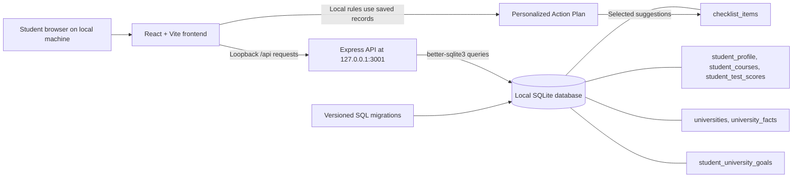

# CollegePath

CollegePath is a full-stack college and career planning demo for high school students. Students can explore rule-based career suggestions from their interests and keep a checklist of college-planning tasks.

## Intended Users

The application is intended for high school students exploring possible careers and organizing college-planning next steps. Recommendations are starting points for exploration, not professional or individualized career guidance.

## Features

- Select interests in Technology, Engineering, Business, Healthcare, Arts, Science, and Law to see related career suggestions.
- Explore curated Cybersecurity, Software Engineering/Computer Science, Mechanical Engineering, Medicine/Healthcare, Business/Finance, and Law roadmaps from relevant career suggestions.
- Review pathway course ideas, advanced course options, technical and people skills, optional activities, project ideas, and flexible grade-by-grade suggestions.
- See how saved courses connect to a pathway and which additional subjects a student could explore. Roadmaps use local rule-based guidance, not external AI.
- Save a local academic profile with grade level, weighted and unweighted GPA, courses, and SAT/ACT scores.
- Add, edit, and delete course and test-score entries; enter letter or percentage grades and optional test dates.
- Search a small catalog of Harvard, MIT, Stanford, UT Austin, and Boston University and save/remove local university goals.
- Review sourced application materials, testing policies, published score ranges, and deadlines. Unverified items are labeled; published ranges are not minimums or admission guarantees.
- Explore general optional preparation ideas, clearly separated from application requirements.
- Generate a local rule-based action plan from saved courses, GPA/test-record availability, grade level, a selected career pathway, and saved university goals.
- Add action-plan suggestions to the existing checklist; recommendation additions prevent duplicate titles and remain tracked with the normal checklist completion controls.
- Create checklist items and mark them complete or incomplete.
- Store checklist items and completion status in SQLite so they remain after page refreshes and backend restarts.
- View distinct pending and completed tasks, with loading, validation, and request-error messages.

GPA values are entered on the student's school scale. Schools vary in GPA weighting; the form accepts values from 0 to 10 as a broad input range, not as a universal scale or admissions cutoff. The academic profile is a local, single-student prototype without authentication. Do not expose it on a public or shared network.

## Technology Stack

- Frontend: React 19 and Vite 8
- Backend: Node.js and Express 5
- Database: SQLite with `better-sqlite3`
- Client checks: Vite production build and Oxlint

## Architecture



The Vite development server proxies `/api` requests to Express at `http://127.0.0.1:3001`. Express binds to loopback only. At startup it creates `checklist_items` if needed and applies versioned, additive SQL migrations recorded in `schema_migrations`. Migration `001_academic_profile.sql` creates the profile, course, and test-score tables without dropping or rewriting existing checklist rows. Migration `002_university_goals.sql` adds the public university catalog, sourced fact records, and local student goals; catalog rows are safely upserted while saved goals are preserved. The local database file is `server/data/collegepath.db`.

## Run Locally in VS Code

Prerequisites: Node.js 20.19+ or 22.12+ and npm. Open the project folder in VS Code.

1. In a VS Code terminal, install the backend dependencies and start Express:

   ```sh
   cd server
   npm ci
   npm start
   ```

   The API listens at `http://localhost:3001`.

2. Open a second VS Code terminal, install the frontend dependencies and start Vite:

   ```sh
   cd client
   npm ci
   npm run dev
   ```

3. Open the Local URL printed by Vite, normally `http://localhost:5173/`. If that port is in use, Vite selects another port and prints its URL.

On Windows PowerShell, use `Set-Location server` or `Set-Location client` in place of `cd` if preferred. Keep both terminals running while using the app.

## Local-only profile privacy

The academic profile API has no authentication and is intended only for a private local prototype. Express binds to `127.0.0.1`; do not change the binding, forward the API or frontend ports, use a shared Codespace for real student information, or deploy this version. No private student data is included in the repository.

## API Endpoints

All endpoints are served by Express on port `3001`.

| Method | Path | Purpose |
|---|---|---|
| `GET` | `/api/health` | Returns `{ "status": "ok" }` to check that the API is running. |
| `GET` | `/api/checklist` | Returns checklist items, newest first. Each item has `id`, `title`, `completed`, and `created_at`. |
| `POST` | `/api/checklist` | Creates a checklist item. JSON body: `{ "title": "Research application deadlines", "completed": false }`. `completed` is optional and defaults to `false`. Titles must be non-empty and at most 200 characters. Returns the created item with HTTP 201. |
| `POST` | `/api/checklist/recommendation` | Adds a recommended action to the existing checklist using `{ "title": "Explore a course or project" }`. Returns the saved item with HTTP 201; a case-insensitive duplicate returns HTTP 409 and the existing item. |
| `PATCH` | `/api/checklist/:id` | Sets an item's completion state. JSON body: `{ "completed": true }` or `{ "completed": false }`. Returns the updated item. Invalid input returns HTTP 400; an unknown item returns HTTP 404. |
| `GET` | `/api/profile` | Returns the local profile, courses, and test scores. Empty profile fields are `null`; collections start empty. |
| `PUT` | `/api/profile` | Saves `{ "gradeLevel": 9, "weightedGpa": 4.2, "unweightedGpa": 3.8 }`. Use `null` for fields not entered. Grade must be 9–12; GPA values must be numbers from 0–10. |
| `GET` | `/api/courses` | Returns this local student's saved courses. |
| `POST` | `/api/courses` | Adds a course with `courseName`, `level`, `grade`, and `schoolYear`. Levels are Regular, Honors, AP, IB, and Dual Credit. Grades accept A–F with optional +/- or 0–100 percentages; years must be consecutive, such as `2025-2026`. |
| `PUT` | `/api/courses/:id` | Updates a course using the same body fields as `POST`. |
| `DELETE` | `/api/courses/:id` | Deletes a course. |
| `GET` | `/api/test-scores` | Returns this local student's saved test-score entries. |
| `POST` | `/api/test-scores` | Adds a `testType` (`sat_math`, `sat_reading_writing`, or `act_composite`), integer `score`, and `testDate` (valid `YYYY-MM-DD` date or `null`). SAT section scores must be 200–800; ACT composite scores must be 1–36. |
| `PUT` | `/api/test-scores/:id` | Updates a test score using the same body fields as `POST`. |
| `DELETE` | `/api/test-scores/:id` | Deletes a test score. |
| `GET` | `/api/universities?search=MIT` | Searches the public catalog by university name or location. Each admissions fact includes its official source URL and last-verified date. |
| `GET` | `/api/university-goals` | Lists this local student's saved university goals. |
| `POST` | `/api/university-goals` | Saves a catalog university using `{ "universityId": "mit" }`. Duplicate goals return HTTP 409; invalid IDs return HTTP 400. |
| `DELETE` | `/api/university-goals/:id` | Removes a saved university goal. |

Profile and academic records are served only by the loopback-bound local server and are not separated by accounts. Do not expose these endpoints publicly.

Career recommendations are computed in the frontend from predefined career data; they do not use an API or external AI service.

The university catalog is a small curated starter set. Admissions details can change; each item links to the official university source and displays its last-verified date. “Not verified — check official admissions website.” means the detail was not confirmed for this catalog. Published score ranges describe the cited class/cohort only and are not minimums or admission guarantees. Preparation ideas are general suggestions, not university requirements. The catalog is reference information, not an admissions prediction.

The Action Plan is generated in the browser from the local Academic Profile, selected career pathway, university goals/catalog, and current checklist. It reuses the curated career roadmap course/activity/project suggestions and only cites official university catalog sources. Profile gaps are called out instead of inferred; school course availability is not assumed. Suggestions are exploratory and do not predict or guarantee admissions. The generated plan itself is not separately persisted; only actions a student adds to the existing checklist are saved in SQLite. Refresh the plan after updating profile or university goals.

## Verify Checklist Persistence

1. Start the backend and frontend using the instructions above.
2. In **My Checklist**, add a task and mark it complete or incomplete. The task should appear in the matching group.
3. Refresh the browser. The task and its completion state should still be shown.
4. Stop and restart only the Express terminal with `Ctrl+C`, then run `npm start` again from `server/`. Refresh the page; the same task and status should remain.
5. To inspect the API response, open `http://localhost:3001/api/checklist` or `http://localhost:5173/api/checklist` (substitute the actual Vite port if it differs). The frontend URL uses Vite's `/api` proxy.
6. To inspect the SQLite file directly, open `server/data/collegepath.db` with a SQLite viewer and query:

   ```sql
   SELECT id, title, completed, created_at
   FROM checklist_items
   ORDER BY id DESC;
   ```

The database file is local and ignored by Git. A new clone or Codespace creates its own database when Express starts; checklist contents are not committed or shared through Git.

## Demo Checklist Data

The development database may contain existing user-created tasks. This workspace also has two clearly labeled demo items:

- `Demo: Compare college application deadlines` (incomplete)
- `Demo: Write questions for a school counselor` (complete)

The demo items were added to the existing local database without modifying existing checklist rows. These local rows are not part of a fresh clone and are not tracked in Git.

## Checks

Run the frontend checks from `client/`:

```sh
npm run build
npm run lint
npm test
```

Run the isolated API and SQLite migration/persistence tests from `server/`:

```sh
npm test
```

The tests use temporary SQLite files and do not read or modify the local `server/data/collegepath.db`.

## Known Limitations

- Career suggestions come from a small, predefined rule-based catalog. They are exploratory examples, not an assessment or a promise of career fit.
- Career interest selections and results are held in page state and are not saved.
- The checklist is shared by anyone using the same local SQLite database; there are no accounts or per-student data separation.
- University goals are likewise stored in the shared local database without accounts; they are not safe to expose on a public or shared network.
- The initial university catalog is intentionally small, and admissions facts need periodic re-verification against the linked official sources.
- Checklist items can be created and marked complete/incomplete, but there are no edit or delete endpoints.
- The app is set up for local development and Codespaces preview. Production deployment and production server configuration are not included.
- SQLite is local to the environment. A fresh clone starts with a new database; ignored local data is not pushed to GitHub.
