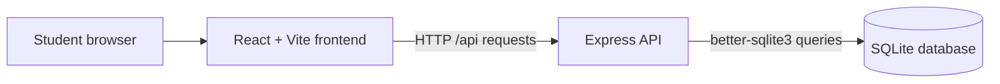

# CollegePath

CollegePath is a full-stack college and career planning demo for high school students. Students can explore rule-based career suggestions from their interests and keep a checklist of college-planning tasks.

## Intended Users

The application is intended for high school students exploring possible careers and organizing college-planning next steps. Recommendations are starting points for exploration, not professional or individualized career guidance.

## Features

- Select interests in Technology, Engineering, Business, Healthcare, Arts, and Science to see three related career suggestions.
- Review each career's description, useful skills, and a suggested next step for a high school student.
- Create checklist items and mark them complete or incomplete.
- Store checklist items and completion status in SQLite so they remain after page refreshes and backend restarts.
- View distinct pending and completed tasks, with loading, validation, and request-error messages.

## Technology Stack

- Frontend: React 19 and Vite 8
- Backend: Node.js and Express 5
- Database: SQLite with `better-sqlite3`
- Client checks: Vite production build and Oxlint

## Architecture



The Vite development server proxies `/api` requests to Express at `http://localhost:3001`. Express creates the database and `checklist_items` table when it starts if they do not already exist. The local database file is `server/data/collegepath.db`.

## Run Locally in VS Code

Prerequisites: Node.js 20.19+ or 22.12+ and npm. Open the project folder in VS Code.

1. In a VS Code terminal, install the backend dependencies and start Express:

   ```sh
   cd server
   npm ci
   npm start
   ```

   The API listens at `http://localhost:3001`.

2. Open a second VS Code terminal, install the frontend dependencies and start Vite:

   ```sh
   cd client
   npm ci
   npm run dev
   ```

3. Open the Local URL printed by Vite, normally `http://localhost:5173/`. If that port is in use, Vite selects another port and prints its URL.

On Windows PowerShell, use `Set-Location server` or `Set-Location client` in place of `cd` if preferred. Keep both terminals running while using the app.

## Run in GitHub Codespaces

Open the repository in a Codespace. In the first Codespaces terminal, install and start the backend:

```sh
cd server
npm ci
npm start
```

In a second terminal, install and start Vite on an interface Codespaces can forward:

```sh
cd client
npm ci
npm run dev -- --host 0.0.0.0
```

Use the forwarded frontend port shown in the Codespaces **Ports** tab (normally port `5173`) and open it in a browser. Keep the Express process running on port `3001`; Vite proxies `/api` requests to it within the Codespace. If you need to call the API directly from outside the frontend, forward port `3001` as well. The Vite proxy target is configured for a frontend and backend running in the same Codespace.

## API Endpoints

All endpoints are served by Express on port `3001`.

| Method | Path | Purpose |
|---|---|---|
| `GET` | `/api/health` | Returns `{ "status": "ok" }` to check that the API is running. |
| `GET` | `/api/checklist` | Returns checklist items, newest first. Each item has `id`, `title`, `completed`, and `created_at`. |
| `POST` | `/api/checklist` | Creates a checklist item. JSON body: `{ "title": "Research application deadlines", "completed": false }`. `completed` is optional and defaults to `false`. Titles must be non-empty and at most 200 characters. Returns the created item with HTTP 201. |
| `PATCH` | `/api/checklist/:id` | Sets an item's completion state. JSON body: `{ "completed": true }` or `{ "completed": false }`. Returns the updated item. Invalid input returns HTTP 400; an unknown item returns HTTP 404. |

Career recommendations are computed in the frontend from predefined career data; they do not use an API or external AI service.

## Verify Checklist Persistence

1. Start the backend and frontend using the instructions above.
2. In **My Checklist**, add a task and mark it complete or incomplete. The task should appear in the matching group.
3. Refresh the browser. The task and its completion state should still be shown.
4. Stop and restart only the Express terminal with `Ctrl+C`, then run `npm start` again from `server/`. Refresh the page; the same task and status should remain.
5. To inspect the API response, open `http://localhost:3001/api/checklist` or `http://localhost:5173/api/checklist` (substitute the actual Vite port if it differs). The frontend URL uses Vite's `/api` proxy.
6. To inspect the SQLite file directly, open `server/data/collegepath.db` with a SQLite viewer and query:

   ```sql
   SELECT id, title, completed, created_at
   FROM checklist_items
   ORDER BY id DESC;
   ```

The database file is local and ignored by Git. A new clone or Codespace creates its own database when Express starts; checklist contents are not committed or shared through Git.

## Demo Checklist Data

The development database may contain existing user-created tasks. This workspace also has two clearly labeled demo items:

- `Demo: Compare college application deadlines` (incomplete)
- `Demo: Write questions for a school counselor` (complete)

The demo items were added to the existing local database without modifying existing checklist rows. These local rows are not part of a fresh clone and are not tracked in Git.

## Checks

Run the frontend checks from `client/`:

```sh
npm run build
npm run lint
```

The server package currently provides `npm start` and `npm run dev`; it does not define a separate automated test script.

## Known Limitations

- Career suggestions come from a small, predefined rule-based catalog. They are exploratory examples, not an assessment or a promise of career fit.
- Career interest selections and results are held in page state and are not saved.
- The checklist is shared by anyone using the same local SQLite database; there are no accounts or per-student data separation.
- Checklist items can be created and marked complete/incomplete, but there are no edit or delete endpoints.
- The app is set up for local development and Codespaces preview. Production deployment and production server configuration are not included.
- SQLite is local to the environment. A fresh clone starts with a new database; ignored local data is not pushed to GitHub.
